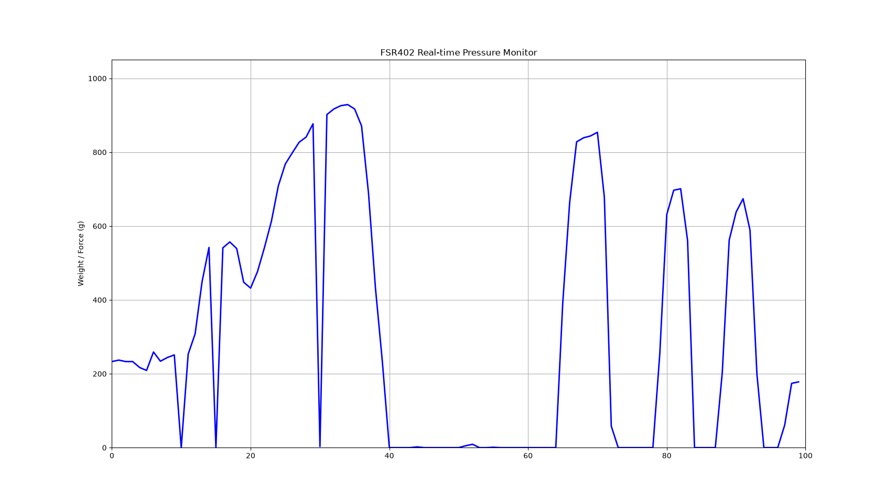
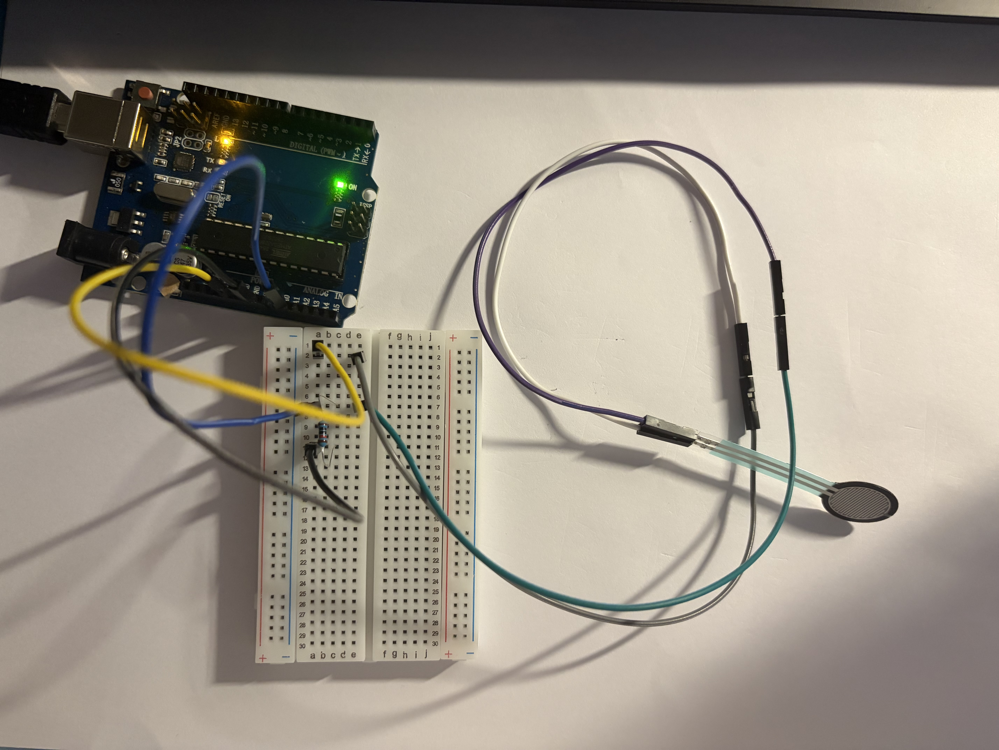
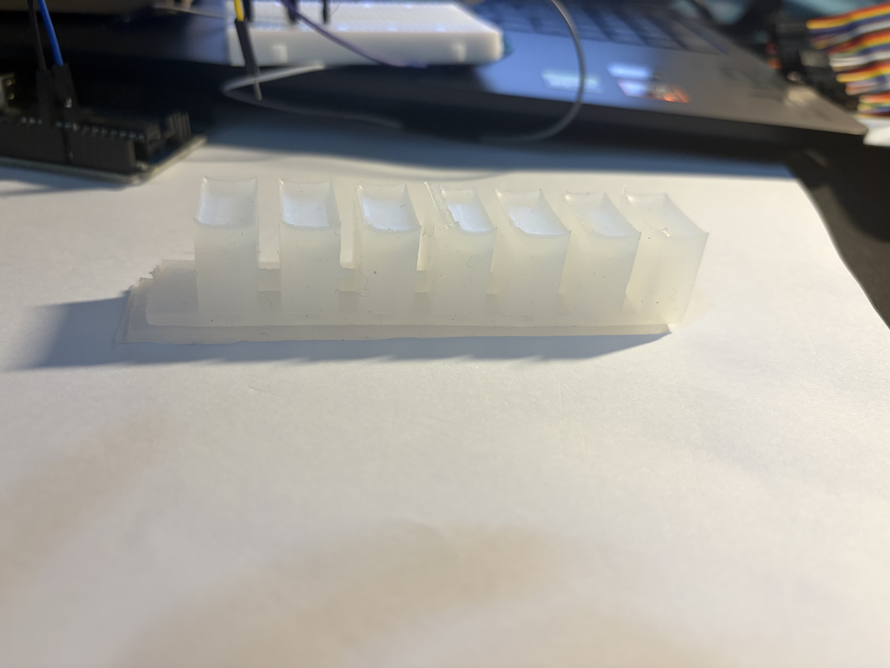
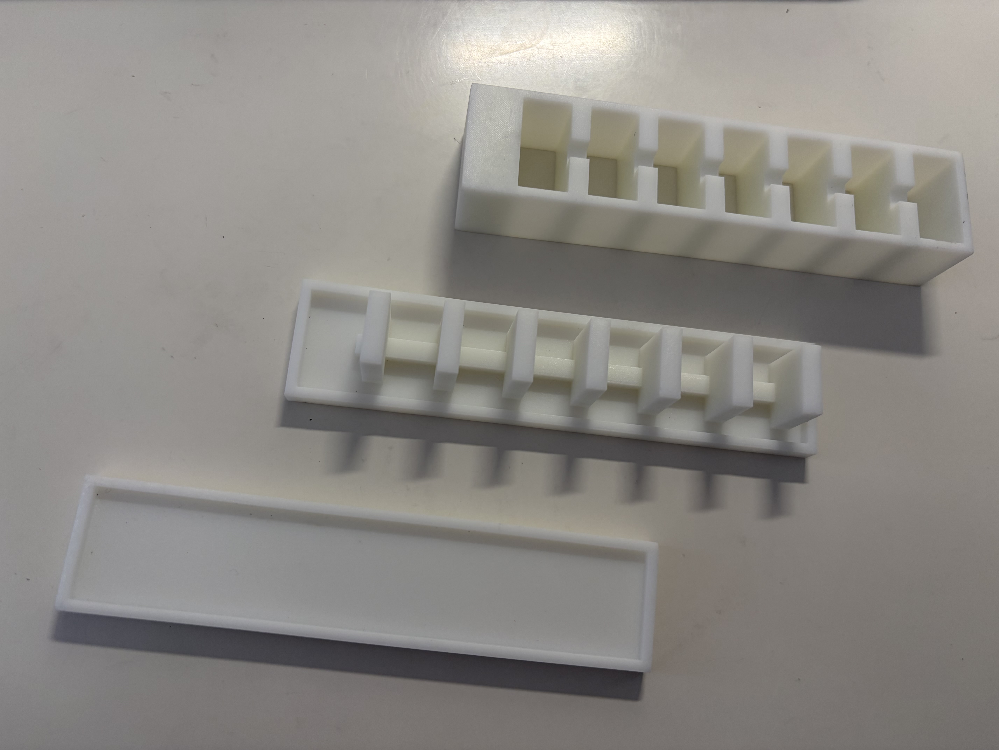

# soft-robot-learning
# 🦾 Exploration in Pneumatic Soft Robotics (PneuNet)

An undergraduate exploration in pneumatic soft robotics, utilizing open-source frameworks and AI assistance to learn hardware-software integration step by step. This repository serves as a transparent log of my initial engineering learning journey.

---

## ⚖️ Acknowledgement & Academic Integrity

To maintain absolute academic transparency, the methodology of this project is outlined below:
- **Design Origin:** The 3D CAD models of the PneuNet mold are reproduced and adapted from the open-source designs of the **Harvard Soft Robotics Toolkit**, modified to suit local material availability and community open-source references.
- **Modeling Tool:** All mechanical components and molding systems were modeled using **SolidWorks Student Edition**.
- **Manufacturing Process:** All mechanical components were modeled in SolidWorks and fabricated via **Industrial-grade SLA Resin 3D Printing (JLC Prototyping / 嘉立创工业级光固化树脂打样)** to achieve an ultra-smooth, glassy mold surface, minimizing mechanical interlocking and tearing during silicone casting and ensuring sub-millimeter geometric accuracy.
- **Software & AI Assistance:** The core code logic for data visualization and Arduino serial configuration was developed with **AI assistance**.
- **My Core Engineering Contribution:** Hardware circuit design, physical sensor wiring, empirical boundary calibration, 3D resin printing logistics, and silicone casting were fully executed and verified independently by me.

---

## 🧩 System Architecture & Engineering Roadmap

### 1. Sensing & Data Acquisition Subsystem 🟢 `[Status: Completed]`
- **Hardware Connection:** Integrated a compatible Arduino UNO board with an **FSR402 Force Sensor** using a custom **Voltage Divider Circuit (分压电路)** via a 10kΩ pull-down resistor. The analog voltage signal is fed into the **A0 analog input pin**.
- **Data Visualization:** Real-time dynamic force tracking and signal plotting executed via integrated serial telemetry tools.
- **Result:** Successfully achieved real-time dynamic data visualization.

*(Below is the live sensor plot when force is applied)*

*(Below is my physical hardware wiring setup)*

### 2. Soft Actuator Subsystem 🟢 `[Status: Completed]`
- **Design:** A 7-chamber PneuNet silicone soft actuator based on Harvard Toolkit and community modifications.
- **Honest Failure Analysis (故障分析):** 
  - **V1.0 (Failed):** Demolding failed completely due to a bottom chamber rupture, caused by the lack of a release agent and micro air pockets trapped during hand-mixing.
  - **V2.0 (Success):** Successfully demolded after modifying the demolding strategy, applying a proper release agent, and optimizing the silicone degassing process within the smooth resin mold.

*(Below is the comparison of my empirical learning process)*

*(Below is the 3D printed resin mold prototype)*

### 3. Closed-Loop Pneumatic Control Subsystem 🚧 `[Status: Next Milestone]`
- **Active Iteration:** Connecting a 1-channel 5V relay and a mini pneumatic pump to the Arduino UNO. 
- **Feedback Loop Logic (阈值反馈闭环):** The FSR402 force sensor will be mounted on the **outer surface** of the soft robotic arm to detect environmental contact. The Arduino will process this analog feedback in real-time; once the contact force reaches a predefined threshold, the system will trigger a software interrupt to stop the inflation pump, preventing structural over-expansion and ensuring safe interactive force bounds.

### 4. Advanced Advanced Material Layer: Granular Jamming 🚀 `[Status: Conceptual Proposal]`
- **Variable Stiffness Mechanism (可变刚度机制):** To bridge the gap between compliance and structural payload, I plan to wrap the soft arm in a custom outer jacket encapsulated with **coffee grounds** (micro-particles).
- **Vacuum Activation:** By utilizing the **Granular Jamming (颗粒阻塞)** effect, drawing a vacuum within the particle jacket will cause the coffee grounds to instantaneously lock together, switching the manipulator from a flexible state to a highly rigid state to handle heavier loads.

---

## 🚀 Iterative Design Optimizations (CAD Upgrades)

To resolve the manufacturing and stress concentration issues discovered during V1.0 and V2.0 casting, the next mold iteration will feature:
1. **Geometric Fillets & Chambers (圆角与倒角优化):** Introducing explicit **Fillets (圆角)** and **Draft Angles (脱模斜度)** on all chamber core interfaces in SolidWorks to minimize localized stress concentration and eliminate silicone tearing during demolding.
2. **Alignment Pins:** Redesigning the outer casing mold to include interlocking mechanical alignment pins, ensuring perfectly symmetrical chamber wall thickness and more predictable bending behavior.

---

## 📂 Repository Layout
- `/Arduino_Code`: C++ scripts for Arduino analog sampling and serial writing (includes detailed AI-assisted comments for my learning reference).
- `/hardware_design`: `.stl` geometric files for the 7-chamber core, outer mold, and base mold.

---
